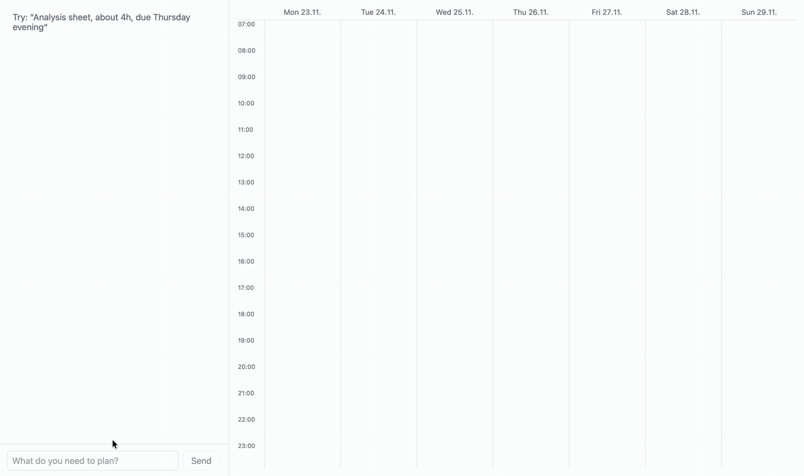

# Calendar Planning Agent

Tell it in plain English what you need to get done ("Analysis sheet, about 4h, due
Thursday evening; keep Wednesday evening free"). It reads your Google Calendar,
plans study blocks around your lectures with a **constraint solver**, shows you a
draft, and writes the blocks to your calendar only after you click **Confirm**.

<!-- Demo GIF: record it as described at the end, save as docs/demo.gif, then use:
 -->

**The idea in one line:** the LLM translates, the solver decides, a checker
verifies, and the LLM explains.

## How it works

```
 Web UI (React)          FastAPI backend                 Agent (Gemini + ADK)
 chat + week view ──────► /api/chat ────────────────────► chooses a tool
       │                                                       │
       │ Confirm                                               ▼
       └──────────► /api/plans/{id}/apply        propose_plan: text ─► parser (DSPy + Gemini)
                         │                                      ─► PlanRequest (Pydantic)
                         ▼                                      ─► CP-SAT solver (OR-Tools)
                   apply_plan ──► Google Calendar               ─► checker ─► draft
                   (idempotent,    ("Study plan" calendar,
                    re-checks)      tagged events only)
```

| Part | Where | LLM? |
|---|---|---|
| Conversation, tool choice, wording the answer | [planner/agent](planner/agent) (Google ADK) | yes |
| Text → structured request (`PlanRequest`) | [planner/parser](planner/parser) (DSPy, versioned prompts) | yes |
| Validation of the request | [schemas.py](planner/parser/schemas.py) (Pydantic) | no |
| Scheduling, and *why* something is impossible | [planner/solver](planner/solver) (CP-SAT) | no |
| Independent check of every plan | [planner/checker](planner/checker) | no |
| Calendar read/write | [planner/calendar](planner/calendar) | no |
| Web API and UI | [planner/api](planner/api), [web](web) | no |

### Safety: how the app avoids damaging your calendar

1. **Google's scope:** the app may only write to the calendar it created itself
   ("Study plan"); everything else is read-only.
2. **Confirm before write:** the agent has no tool that writes. Only the
   Confirm button calls the backend's apply step.
3. **Re-check before writing:** if a new event clashes since the preview,
   nothing is written.
4. **Tags:** the app edits or deletes only events tagged `created_by=planner`.
5. **Idempotent apply:** clicking Confirm twice, or retrying after a crash,
   never creates duplicates.

## Results

Evaluated on 50 hand-checked requests (35 train, 15 held-out test), with
`gemini-3.5-flash-lite`. **Success** = the right "impossible" answer, or a plan
that breaks no rule when checked against the correct (gold) request.

| Approach | Test success |
|---|---|
| Gemini plans directly (Baseline A, two runs) | 73%, 67% |
| Parser + solver, hand-written prompt (Baseline B) | 93% |
| Parser + solver, GEPA-optimised prompt + hand fix | **100%** (15/15) |

The parser + solver approach beat direct LLM planning in every run on both
splits. Direct planning failed on totals and rules; parser + solver failed
only where the parser misread the wording. With 15 test cases, one case is
about 7 points, so the comparison is a clear signal, not a precise number.
Details and error analysis: [evals/README.md](evals/README.md).

## Run it locally

Requirements: [uv](https://docs.astral.sh/uv/), Node 24, a Gemini API key
(Google AI Studio, free tier is enough).

```bash
uv sync                                   # Python dependencies
cp .env.example .env                      # then put your GOOGLE_API_KEY in .env
cd web && npm ci && cd ..                 # frontend dependencies
```

**Web app** (two terminals; the calendar is a fake week of lectures):

```bash
uv run uvicorn planner.api.main:app --reload       # terminal 1: backend, port 8000
cd web && npm run dev                              # terminal 2: open http://localhost:5173
```

If Gemini is busy, try a lighter model: prefix the backend command with
`PLANNER_MODEL=gemini-3.5-flash-lite`.

**With your real Google Calendar:** create a Google Cloud project with the
Calendar API, an OAuth client of type *Desktop app* (save it as
`credentials.json`, git-ignored) and the scopes `calendar.app.created`,
`calendar.events.readonly` and `calendar.calendarlist.readonly`. Then:

```bash
uv run python -m planner.calendar.auth            # log in once in the browser
PLANNER_CALENDAR=google uv run uvicorn planner.api.main:app
```

**Terminal chat** instead of the web app: `uv run python -m experiments.planner_agent.chat`

### Checks

```bash
uv run pytest            # ~400 tests, no network (fake Gemini, fake calendar)
uv run ruff check . && uv run mypy
cd web && npm test && npm run typecheck
```

### Evals and prompt optimisation (use Gemini quota)

```bash
uv run python -m planner.evals.run --baseline parser_solver --split train --pause 5
uv run python -m planner.evals.run --baseline direct --split train --pause 5
uv run python -m planner.evals.optimize --budget 150     # GEPA, train split only
```

## Docker and deployment

The image builds the frontend and serves it from the same FastAPI server:

```bash
docker build -t calendar-planner .
docker run -p 8080:8080 -e GOOGLE_API_KEY=... calendar-planner   # http://localhost:8080
```

CI builds this image and checks `/api/health` on every push. The project is
not deployed: Cloud Run needs a billing account, which this project
deliberately doesn't use. With billing enabled, deployment would be:

```bash
gcloud secrets create gemini-key --data-file=-          # paste the key, Ctrl+D
gcloud run deploy calendar-planner --source . --region europe-west6 \
  --set-secrets GOOGLE_API_KEY=gemini-key:latest --allow-unauthenticated
```

A public deployment should stay on the fake calendar: the app is single-user
(see below).

## Limitations

- **Single user, state in memory.** Drafts live in the server's memory (a
  restart forgets unconfirmed drafts), there is one chat session, and one
  Google login (`token.json`). Multiple users would need a database for drafts,
  a web OAuth flow with per-user tokens, and authentication on the API.
- **Parser mistakes are the main failure mode.** E.g. "fit 20 hours" is read
  as a 20-hour daily limit; deadlines on daylight-saving days can be off by an
  hour.
- **Moved events:** if you drag one of the app's events to another time, the
  app no longer recognises it as part of the plan.
- **Free-tier Gemini** can be slow or rate-limited; the app reports this
  instead of guessing.

## Project layout

```
planner/
  agent/      ADK agent and its tools (no write tool)
  parser/     DSPy parser, PlanRequest schema, versioned prompts
  solver/     CP-SAT model and infeasibility explanations
  checker/    independent rule checker
  calendar/   CalendarBackend, FakeCalendar, GoogleCalendar, OAuth, apply_plan
  api/        FastAPI app
  evals/      dataset, baselines, scoring, GEPA
web/          React + TypeScript (Vite) frontend
evals/        eval cases, results, error analysis
docs/         brief and design decisions
```

Every design choice is recorded with its alternatives in
[docs/decisions.md](docs/decisions.md).

## Recording the demo GIF

Run the web app, record the screen with QuickTime (File → New Screen
Recording, select the browser window), then convert:

```bash
brew install ffmpeg
ffmpeg -i demo.mov -vf "fps=10,scale=1000:-1" docs/demo.gif
```
